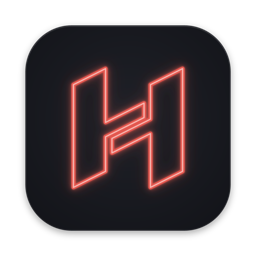
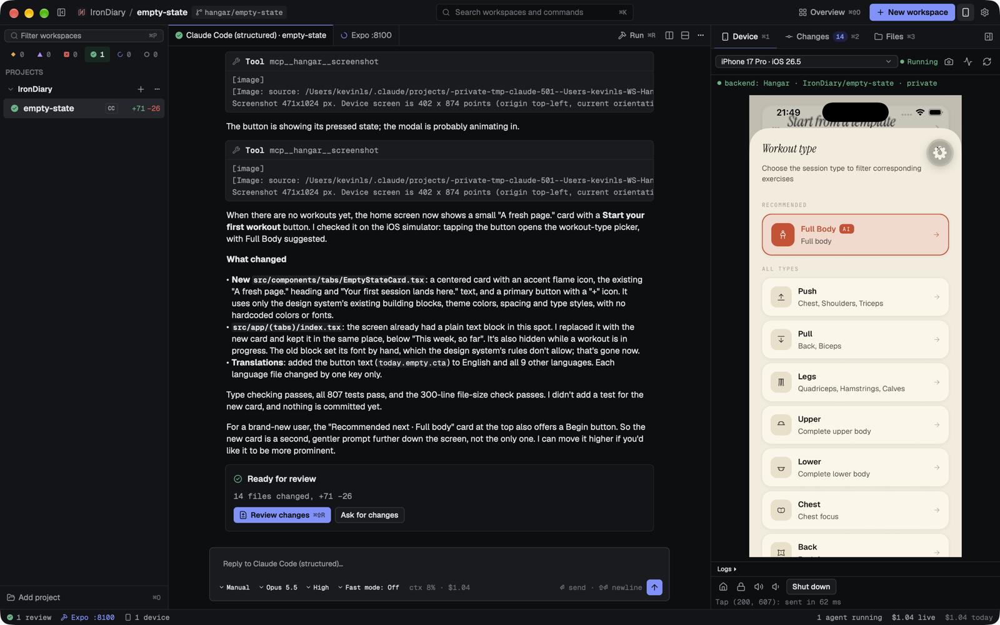
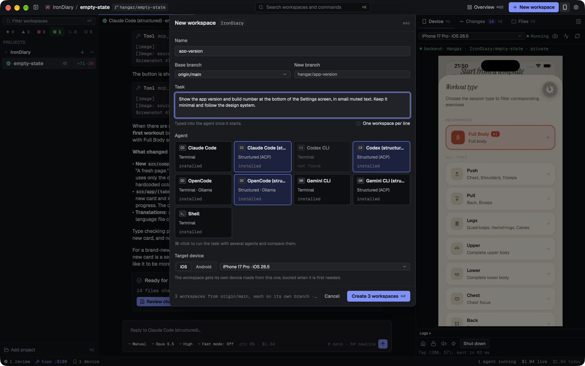
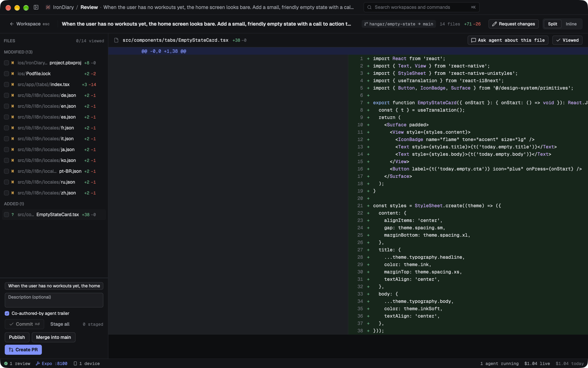
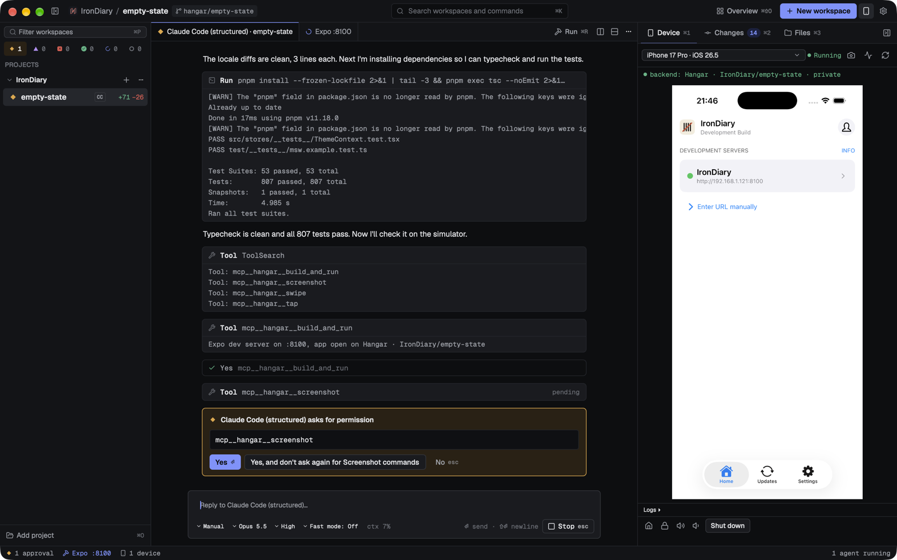
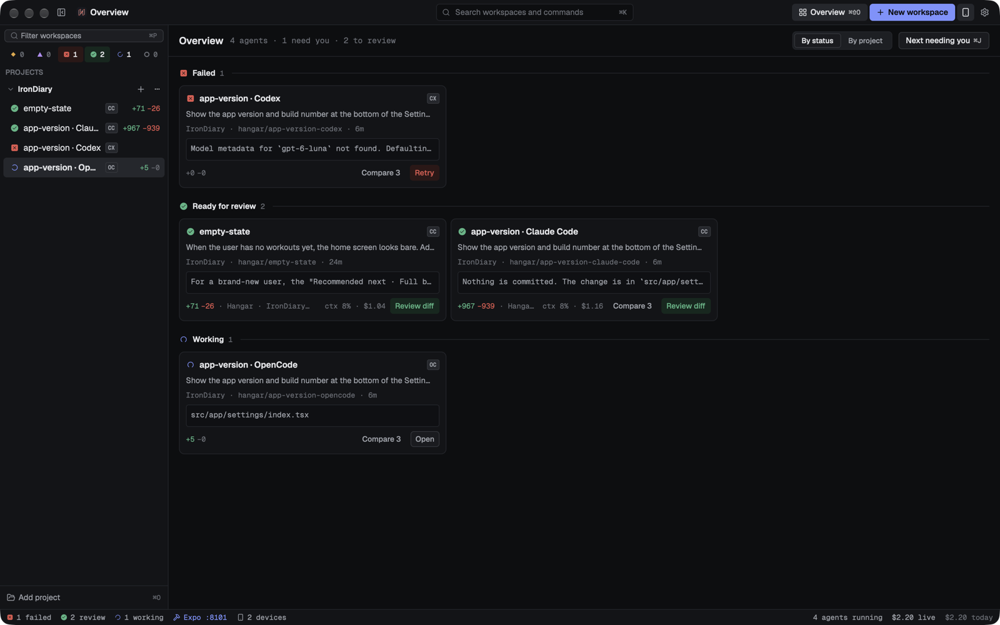
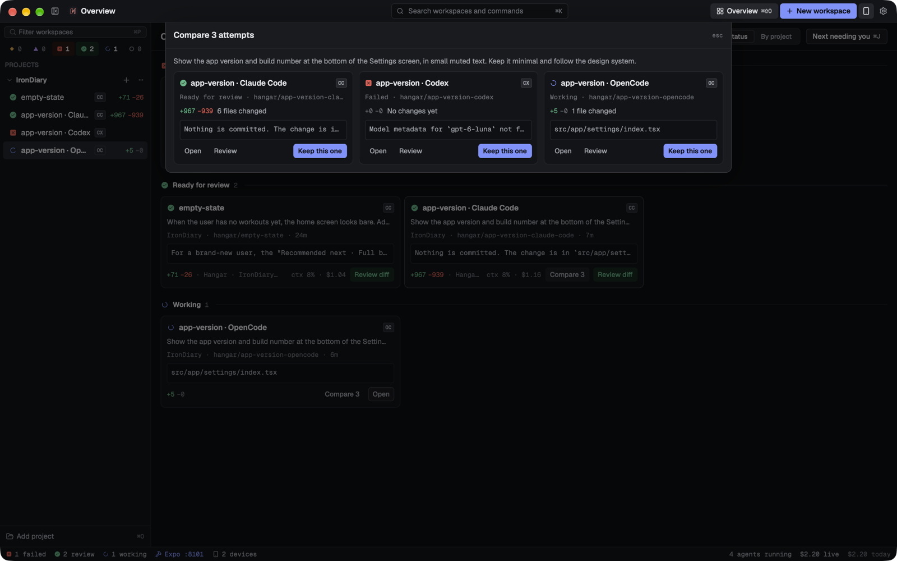
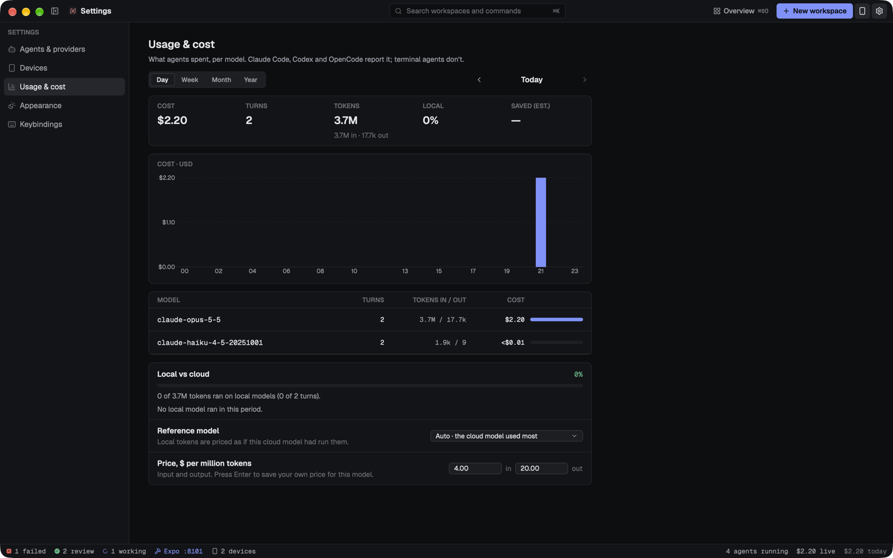
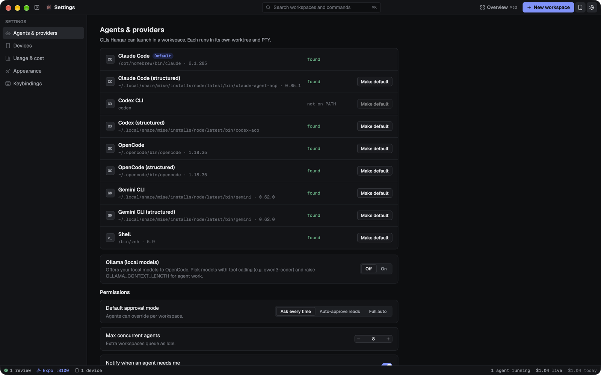

<div align="center">



# Hangar

**Run your coding agents in parallel — each in its own worktree, each with its own simulator.**

A native macOS app, written in Rust with [GPUI](https://www.gpui.rs), for mobile developers who work
with Claude Code, Codex, OpenCode or Gemini CLI.

[](https://github.com/KVNLS/Hangar/actions/workflows/ci.yml)




<sub>Claude Code added an empty state to an Expo app, ran the tests, built the app with Hangar's
<code>build_and_run</code> tool and checked the result on the simulator itself.</sub>

</div>

## Why Hangar

- **Your agents, your accounts.** Hangar runs the CLIs you already use. It never proxies a model call.
- **One task, one worktree.** Every workspace is a Git worktree on its own branch, so agents never step on
  each other and you review each change on its own.
- **Built for mobile.** Each workspace can get its own iOS simulator or Android emulator, shown live in the
  window, and agents can drive it themselves to check their UI work.
- **Native and fast.** Rust and GPUI, no Electron. The iOS simulator framebuffer is painted straight from
  its IOSurface, without a CPU copy.

## Features

### Parallel workspaces
Add a repository, start as many workspaces as you like, and pick an agent for each. Hangar creates the
worktree and branch, starts the agent in it, and keeps projects, workspaces and sessions across restarts.
A sidebar shows every agent's state (working, waiting for approval, needs input, done), and macOS
notifications tell you when one needs you.



### Terminal or structured agents
Run an agent as a plain terminal (PTY + `alacritty_terminal` emulation), or as a **structured agent**
through the [Agent Client Protocol](https://agentclientprotocol.com): a chat pane with tool-call cards,
permission prompts, modes, model and effort pickers, slash commands and session resume. OpenCode can also
run on local [Ollama](https://ollama.com) models.

### Live changes and review
Files are watched as agents write them. The review screen shows the workspace's diff (split or inline,
with syntax highlighting), and lets you commit, push, rebase, merge into the base branch or open a pull
request through `gh`.



### Devices in the window
- **iOS simulator**: headless boot, live frames, taps, swipes, keyboard and hardware buttons through the
  private CoreSimulator frameworks, with a public `simctl` fallback.
- **Android emulator**: frames and input over the emulator's gRPC console, with an `adb` fallback.
- **Device pool**: one device per workspace, cloned on demand, with a limit on how many run at once. At the
  limit, workspaces share a running device and wait their turn: the device panel shows who holds it and
  who is next, with a **Take over** button.
- **Platform switch**: a workspace has one platform attached at a time. Switch from the device picker, or
  let the agent switch; the other device is parked and reused when you switch back.
- **Logs** pane, screenshots (⌘S), rotation where the platform allows it.

### Run loop
⌘R builds and runs the workspace on its device: Xcode, Gradle, React Native and Expo projects. Each
worktree gets its own Metro / Expo port, so several dev servers run side by side.

### MCP tools for agents
Every agent gets a `hangar` MCP server, so it can check its own work on the device. An agent acquires the
device before a sequence of calls and waits in line when it is shared. Each call goes through the same
permission prompts as any other tool:



| Device | Orchestration |
|---|---|
| `device_info`, `device_acquire`, `device_release`, `screenshot`, `tap`, `swipe`, `type_text`, `press`, `logs`, `launch_app`, `build_and_run` | `workspaces_list`, `workspace_create`, `agent_prompt`, `agent_transcript`, `ask_user` |

### Orchestration
An overview of every agent, an approvals inbox, a queue with a "max concurrent agents" limit, and
**best-of-N**: start the same task with several agents and compare their attempts side by side. Usage and
cost are tracked per session and per day.

<table>
  <tr>
    <td></td>
    <td></td>
  </tr>
  <tr>
    <td></td>
    <td></td>
  </tr>
</table>

## Supported agents

Hangar detects which CLIs are on your `PATH` (Settings › Agents & providers).

| Agent | Terminal preset | Structured preset (ACP) | ACP adapter |
|---|---|---|---|
| Claude Code | `claude` | `claude-acp` | `npm install -g @agentclientprotocol/claude-agent-acp` |
| Codex CLI | `codex` | `codex-acp` | `npm install -g @zed-industries/codex-acp` |
| OpenCode | `opencode` | `opencode-acp` | built in (`opencode acp`) |
| Gemini CLI | `gemini` | `gemini-acp` | built in (`gemini --acp`; needs an API key) |
| Shell | `shell` | — | — |

## Getting started

### Install a release

Download `Hangar-<version>-arm64.dmg` from [Releases](https://github.com/KVNLS/Hangar/releases) and drag
Hangar to Applications. Builds are signed with a development certificate but not notarized, so macOS blocks
the first launch: right-click Hangar › Open › Open, or run
`xattr -dr com.apple.quarantine /Applications/Hangar.app`. Apple Silicon only for now.

### Build from source

Requirements:
- macOS, Rust (the toolchain in `rust-toolchain.toml` installs itself through `rustup`)
- Xcode for the iOS simulator; the Android SDK and an AVD for Android (optional)
- `git`, and `gh` for pull requests (optional)
- At least one of the agents above

On first launch the welcome screen checks these for you and shows the command for anything missing;
Settings › Setup keeps the full list and re-checks after you install something.

```sh
git clone git@github.com:KVNLS/Hangar.git
cd Hangar
cargo run -p hangar-app
```

Data lives in `~/Library/Application Support/Hangar/` (`hangar.db` and `worktrees/`). Set `HANGAR_DB` and
`HANGAR_WORKTREES` to use other paths.

## Architecture

Hangar is one Cargo workspace laid out as ports and adapters. Only `app` depends on GPUI; everything else
is headless and tested without a window. The dependency rule is enforced by
[`crates/app/tests/architecture.rs`](crates/app/tests/architecture.rs).

```
                 ┌──────────── driving adapters ────────────┐
                 │  app (GPUI views)   mcp server/bridge  dev │
                 └───────────────┬───────────────────────────┘
                                 ▼
               usecases  (application services, headless)
                                 │
                                 ▼
               core  (domain model, pure rules, port traits)
                                 ▲ implemented by
     ┌──────────┬──────────┬─────┴─────┬──────────┬──────────┐
  store-sqlite  worktree   agents     devices    files     runner
  (rusqlite)    (git/gh)   (pty/acp)  (simctl…)  (notify)
```

| Crate | Owns |
|---|---|
| `core` | Domain: projects, workspaces, sessions, agent state, devices, changes, review; port traits |
| `usecases` | Application services and pure policies: queue, attention, best-of-N, history |
| `store-sqlite` | SQLite store |
| `worktree` | `git` / `gh` CLI wrapper |
| `agents` | Agent launch, ACP client, Ollama, Claude Code transcripts |
| `terminal` | PTY, terminal emulation, key encoding |
| `files` | Git-ignore-aware file watching, live diff |
| `devices` | `Device` trait; iOS (private frameworks + `simctl`), Android |
| `runner` | Build and run for Xcode, Gradle, React Native, Expo |
| `mcp` | MCP server, socket server and stdio bridge for agents |
| `app` | The GPUI app: every view and the wiring |

More in [docs/ARCHITECTURE.md](docs/ARCHITECTURE.md).

## Development

```sh
cargo build --workspace
cargo fmt --all
cargo clippy --workspace --all-targets -- -D warnings
cargo test --workspace
```

The app has development hooks that drive it without clicks (open a repository, start an agent, send a
prompt, show a given screen). They are listed at the top of
[`crates/app/src/main.rs`](crates/app/src/main.rs). For example:

```sh
HANGAR_DB=/tmp/hangar.db HANGAR_WORKTREES=/tmp/worktrees \
HANGAR_DEV_OPEN=~/code/my-app HANGAR_DEV_AGENT=claude-acp HANGAR_DEV_INPUT="Fix the login screen" \
cargo run -p hangar-app
```

The terminal and simulator spikes are runnable from `examples/`; their results are in [docs/notes/](docs/notes/).

## Status

Hangar is early and moving fast. Milestones M1–M9 are in (terminal, workspaces, review, Android and iOS
devices, run loop, structured agents, MCP device tools, orchestration); M10 (hardening, notarized `.app`)
is in progress. v0.2.0 adds device sharing between agents and platform switching; release notes are in
[docs/releases/](docs/releases/). See [PLAN.md](PLAN.md) for the roadmap and known gaps, and
[docs/HISTORY.md](docs/HISTORY.md) for what shipped.

## Acknowledgements

Built on [GPUI](https://github.com/zed-industries/zed/tree/main/crates/gpui) and
[gpui-component](https://github.com/longbridge/gpui-component), with
[alacritty_terminal](https://github.com/alacritty/alacritty) and
[portable-pty](https://github.com/wezterm/wezterm/tree/main/pty). The simulator work learned from
baguette, SimView and [idb](https://github.com/facebook/idb) (no code copied; see [CREDITS.md](CREDITS.md)).
